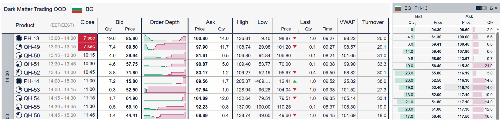

# SOFTWARE ENGINEER INTERVIEW TASK

## THE ORDER BOOK HISTORY

___INTRO.___ One of the segments of the short-term Energy Market, on which DMT trades, is the Intraday Continuous Market (IDC). IDC, like any continuous stock market, is a collection of currently available market orders. Market orders are defined by their quantity, in our case the power measured in MW, their price, measured in EUR per MWh of transacted energy, and their side, "bid/buy" or "ask/sell". Participants looking to buy power place "bid/buy" orders, and those looking to sell place "ask/sell" orders. Whenever a buy order is priced at or above a sell order, the two match and a trade happens.

___THE ORDER BOOK.___ The picture below shows the state of the Order Book.



_(Left)_ An overview of the market: all the products you can trade, e.g. energy delivered between 1300-1400 EET (PH-13) or between 1315-1330 EET (QH-50), each with its best (highest) bid and best (lowest) ask.

_(Right)_ For one product, the orders at each price, with quantities at the same price added together. Bids are sorted by price descending and asks by price ascending, so the most relevant orders come first on both sides.

This picture is only a moment. Every message from the exchange adds, changes or removes orders, so the book is a state that changes many times a second.

___HISTORY.___ Our strategies need the book as it is *now*. Almost everything else needs the book as it *was*, and needs it fast:

- **A live strategy** reads the recent history of the book over and over, following it continuously or re-reading the last hours or days every few seconds to compute its signals. It needs that history right up to now, as close to real time as possible, and each read must be cheap enough to repeat. A strategy restarting in the middle of the day is the same reader, starting cold.
- **A backtest** replays a whole year, message by message, to test a strategy. If that takes five days instead of one, we test five times fewer ideas.
- **Model training** loads a month or more of many products at once.
- **A compliance officer** asks, six months later, *"what did the book of QH-50 look like at 10:04:12.345, when we sent that order?"*

They all read the same data, but differently. The live strategy needs its data **soon**: every change readable a moment after it arrived, and the recent past cheap to read again and again. What matters for it is how fresh the data on disk is and how little has to be read each time. The backtest needs its data **quick**: a whole year, as fast as the disks and cores allow. What matters for it is how much can be read per second, and whether the work can be split up. Training reads many products side by side, and compliance reads a single moment. Soon and quick pull the design in different directions.

**How the data is processed, written and formatted when it is captured decides how fast each of them can read it later.** You cannot make a slow format fast after the fact without rewriting years of data.

The obvious approaches all fail somewhere. Saving a full copy of every book after every message is simple, but far too big: we keep years of this. Saving only the changes is small, but then answering "the book at 10:04:12.345" means replaying everything before it. And keeping the raw JSON messages means every reader pays for parsing them, every time it reads. Somewhere in between is a design, and designing it is your task.

___TASK.___ The task has two parts. Part 1, below, is code. Part 2, at the end, is a written design that builds on it.

___PART 1: THE STORE.___ You will be given three hours of real messages from the Bulgarian market, as we recorded them on 24 September 2026 between 11:25 and 14:25 local time, in two files:

- `localview.jsonl`, about 1 GB (963,161 lines): the changes to the orders;
- `contracts.jsonl`: the products.

Each line is one JSON object:

- `timestamp_utc` is the moment we received it;
- for localview only, `stomp_headers` holds the headers the exchange sent with the message, among them `x-nps-snapshot` and `x-nps-sequenceNo`;
- `body` is the message itself, exactly as the exchange sent it. A localview body is a list of contracts with their changed orders; a contracts body is one contract.

Products in localview are identified by their contractId, while contracts tell you, for each contractId, its name and delivery period.

The exchange's documentation describes the messages: see [/localview](https://developers.nordpoolgroup.com/reference/pmd-localview) and [/contracts](https://developers.nordpoolgroup.com/reference/pmd-contracts). For background on how the stream itself works, see [main concepts](https://developers.nordpoolgroup.com/reference/ws-api-main-concepts) and [message sequencing](https://developers.nordpoolgroup.com/reference/message-sequencing). The file is large on purpose. Start with its first hundred thousand lines, and keep in mind that a full day of this market is about ten times as much, and a week about seventy.

You only need contracts/products that have `'ACTI'` status and are active in Bulgaria (dlvryAreaId __46__). Consume the lines of both files in the order we received them, by `timestamp_utc`. An order is identified by its orderId: when an order appears again, the new version replaces the old one, and orders with `"deleted": true` are removed from the book. A message whose headers say `"x-nps-snapshot": "true"` is a complete picture: it lists every open contract with all of its orders (an empty list means no orders), and it *replaces* what you had rather than being added to it. The exchange sends one when a connection starts, or starts again, and that happens several times in this file, sometimes minutes apart.

Write two programs:

1. **`ingest`** reads the input line by line and writes the history of the order book into a **store on disk of your own design**. Do not use a database or an existing file format (SQLite, DuckDB, Parquet, …); general-purpose compression (zstd, lz4, …) is fine. We will also stop `ingest` with `kill -9` at a random moment. After that, the store must still open and must hold the history exactly up to some line: nothing half-written, nothing missing before that line.
2. **`query`** answers from the store only, never from the .jsonl files:
    - `query status`: the number of the last line of localview.jsonl fully in the store;
    - `query book <product> <T>`: the book of one product (by name) as it was at time T. This is the compliance question;
    - `query top <T>`: the best bid and best ask of every product at time T (the left side of the picture);
    - `query replay <from> <to>`: what a live strategy reads. It prints the book of every product at `from`, followed by every change to it up to `to`, in arrival order. With `to` given as `follow`, it does not stop: after the history it keeps printing new changes as `ingest` stores them, until it is killed.

    T, `from` and `to` are UTC times such as `2026-09-24T10:04:12.345Z`. "At time T" means after every line with `timestamp_utc` ≤ T.

    `query` must also work **while `ingest` is still running**, and see the history up to a moment ago. That is what *soon* means for a live strategy.

___CRITERIA.___ You may use the language of your choosing, C++ preferred. Correctness is above all else: the book you give back for any product at any moment must be exactly the one the messages received up to that moment describe. After that we care about the design of your store, and you will defend it in the following interview:

- how the history is laid out on disk, and why;
- how big it is compared with localview.jsonl;
- how much work a `query book` for an arbitrary moment does, and how that grows with the length of the history;
- **how *quick* your store reads back.** Time `query replay` over the whole input, and tell us what that means for a week and for a month of this market;
- **how *soon* your data can be read.** While `ingest` is running, how long does it take from `ingest` reading a line until `replay … follow` prints its change, and what decides that?
- what exactly survives a `kill -9`, and how you know.

Speed is not a race here. But a store from which a strategy cannot load a week in a reasonable time, or cannot see the last minute, is not a solution.

Include a short note (a page at most) describing your layout and the trade-offs you chose, with your measurements. Part 2 is judged on the written design and on the discussion of it in the interview.

___EXAMPLE OUTPUT.___ Prices are in EUR cents and quantities in kW, as in the API inputs, so values are always integers. `query book PH-20260924-15 2026-09-24T10:04:12.345Z` prints the aggregated book as a JSON dictionary, with [price, quantity] pairs, bids descending and asks ascending:

```json
{ "PH-20260924-15": {"bid": [[19023, 10000], [19022, 4000], [18062, 900], ...], "ask": [[20500, 2800], [20720, 5000], [21379, 4000], ...]} }
```

`query top 2026-09-24T10:04:12.345Z` prints one entry per product, with `null` for an empty side:

```json
{ "PH-20260924-15": {"bid": [19023, 10000], "ask": [20500, 2800]}, "QH-20260924-54": {"bid": [18522, 2400], "ask": [23186, 700]}, ... }
```

`query replay <from> <to>` (and `… follow`) prints one JSON object per line, where `t` is the `timestamp_utc` of the line that caused it. The first lines carry the full book of every product at `from`, with `t` set to `from`. After that there is one line per product per input message that changed its book, giving the new total quantity at each price that changed, with 0 when a price level disappeared:

```text
{"t": "2026-09-24T10:00:00Z", "product": "PH-20260924-21", "bid": [[28221, 9000], [28210, 800], ...], "ask": [[29597, 300], [29624, 1000], ...]}
...
{"t": "2026-09-24T10:00:00.510741+00:00", "product": "PH-20260924-21", "bid": [], "ask": [[31233, 0], [31243, 1000]]}
...
```


___PART 2: THE BIGGER PICTURE.___ The store from Part 1 records one market on one machine. In reality we trade several markets every day, and the order book is only one of our feeds. There are also the trades, the contracts themselves, and external data such as weather and power-production forecasts, which are re-issued several times a day. All of it is captured on the machines that trade, and all of it is kept for years.

The readers from ___HISTORY___ now want it at that scale:

- **Live strategies** on the trading machines read the recent history of every market they trade, continuously or every few seconds, and need it as close to real time as possible. A strategy restarting mid-day needs its last week in seconds. This is *soon*.
- **Backtests** replay 12 months, message by message, in the order we received it, with nothing the strategy could not have known at that moment, and give the same result every time they run. A 12-month backtest should take about a day, not five. This is *quick*.
- **Model training** needs many products and many months at once, sampled on a regular grid (say every second: best bid and ask, the quantity at the first few levels, the last trade), and joined with the forecast *as it was known at that time*, not a later, corrected one.

Design the system that sits between the capture and these readers. There is no code for this part. Write at most two pages (a diagram is welcome) and be ready to discuss it in the interview. We would like you to cover:

- where the data lives, from the trading machine to long-term storage, and how it gets there: what has to be close and fresh for the *soon* reader, and what can be far and cheap for the *quick* one;
- how the data is processed and in what form it is written for each reader: the recent past for live strategies, the whole history for backtests, the sampled grids for training. What is kept raw, and what is derived from it;
- how a 12-month backtest runs in about a day: what it reads, how much of it, and how the work is split up;
- how every backtest and every training job sees the *same* book, rather than each program rebuilding it in its own way, and how a derived dataset gets rebuilt when the code that produced it turns out to have a bug;
- how nothing becomes known too early: no future order book, no forecast before it was published;
- how you know the data is complete and correct, for example after a capture machine was down for an hour, or after a reconnect in the middle of the day;
- how big it all gets and how long each reader waits. Use localview.jsonl and your measurements from Part 1 to estimate.

There is no single right answer. We are interested in which problems you see and how you weigh them against each other.

___PRACTICALITIES.___ We expect this to take about two days.

- **AI tools.** You may use any tools you normally use, AI assistants included. Tell us in your note where and how you used them. In the interview we will ask you to walk us through any part of your code and to change it together with us, so make sure you understand everything you send.
- **Questions.** If anything is unclear (the data, the format, what we mean by a requirement), contact us. Asking costs you nothing; we would much rather answer a question than read a good solution to the wrong problem. Where you decide something yourself instead, say what you decided in your note.
- **What to send.** Your code with instructions to build and run it; the note from Part 1, with your measurements and the total size of your store in bytes after ingesting the whole input; and your Part 2 design.

_Good Luck!_
